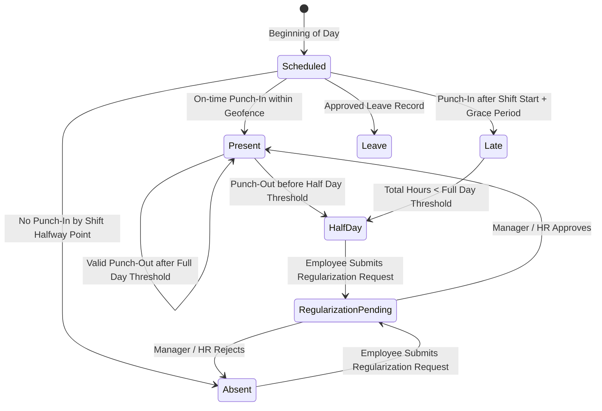

# WorkforcePro — GPS, Selfie & Attendance Rules Specification

## 1. Attendance State Machine & Punch Lifecycle

The daily attendance status of an employee is computed deterministically from punch events, assigned shift parameters, approved leave records, and approved regularizations.



### 1.1 Attendance States
* `PRESENT`: Total logged work hours equal or exceed `shift.fullDayThresholdHours` (e.g., 8 hours) with verified geofence punches.
* `LATE`: First punch-in occurred after `shift.startTime + shift.gracePeriodMinutes`, but total hours still meet minimum full-day criteria.
* `HALF_DAY`: Total logged work hours exceed `shift.halfDayThresholdHours` (e.g., 4.5 hours) but fall short of `fullDayThresholdHours`, or punch-in/out occurs only for one half of the shift.
* `ABSENT`: No verified punch-in recorded, or total work hours are below `shift.halfDayThresholdHours` without an approved leave.
* `ON_DUTY`: Employee on authorized off-site business travel or client deployment.
* `WEEK_OFF`: Scheduled weekly rest day (e.g., Saturday / Sunday).
* `HOLIDAY`: Company-wide or branch-specific declared public holiday.

---

## 2. GPS & Geofence Validation Engine

### 2.1 Server-Side Spatial Verification (Zero Trust Client)
The mobile client reports raw coordinates `(lat, lng)` and horizontal accuracy `accuracyMeters`. The server never trusts a client-side boolean flag. The server recalculates distance against assigned branch geofences.

#### Haversine Formula for Circular Geofences
Let $(\phi_1, \lambda_1)$ be the office latitude and longitude, and $(\phi_2, \lambda_2)$ be the punch coordinates in radians:

$$\Delta\phi = \phi_2 - \phi_1, \quad \Delta\lambda = \lambda_2 - \lambda_1$$

$$a = \sin^2\left(\frac{\Delta\phi}{2}\right) + \cos(\phi_1)\cos(\phi_2)\sin^2\left(\frac{\Delta\lambda}{2}\right)$$

$$c = 2 \cdot \operatorname{atan2}\left(\sqrt{a}, \sqrt{1 - a}\right)$$

$$d = R \cdot c \quad \text{where } R = 6,371,000 \text{ meters}$$

#### Evaluation Rule:
$$\text{IsWithinGeofence} = d \le (\text{geofence.radiusMeters} + \min(\text{accuracyMeters}, 20))$$

> [!NOTE]
> A dynamic GPS accuracy buffer (up to a hard cap of 20 meters) is added to account for urban canyon reflections and cloud cover, preventing false rejections for employees physically inside the building. If `accuracyMeters > 50`, the punch is rejected with an error instructing the user to obtain a clearer satellite signal.

### 2.2 Polygon Geofence Validation
For campus environments with irregular boundaries, the Ray-Casting Point-in-Polygon (PIP) algorithm is executed on the server using GeoJSON coordinates.

---

## 3. Anti-Spoofing & Mobile Device Integrity Architecture

```
+-----------------------------------------------------------------------------------+
|                            MOBILE CLIENT INTEGRITY LAYER                          |
+-----------------------------------------------------------------------------------+
| 1. Android Location API Check: location.isMock() (API 31+) / isFromMockProvider() |
| 2. Android Settings Check: Settings.Secure.ALLOW_MOCK_LOCATION                     |
| 3. Environment Check: SafeDevice.isRooted, SafeDevice.isRealDevice, isEmulator    |
| 4. Camera Hardware Lock: Direct In-App SurfaceView (No Gallery Picker intent)     |
| 5. Hardware Fingerprint Binding: Signed header containing deviceId                |
+-----------------------------------------------------------------------------------+
                                          |
                                          v (HTTPS REST Multipart Upload)
+-----------------------------------------------------------------------------------+
|                            BACKEND VERIFICATION GATEWAY                           |
+-----------------------------------------------------------------------------------+
| 1. Re-calculate Haversine distance against authorized tenant geofences           |
| 2. Compare deviceId against employee.boundDeviceId in DB                         |
| 3. Compare clientTimestamp with server NTP monotonic time (Max drift: 180s)       |
| 4. Compute SHA-256 hash of selfie image; verify against recent hashes (no replay) |
| 5. Process facial liveness score / minimum face detection criteria               |
| 6. Persist audit record in attendance_punches with raw telemetry                  |
+-----------------------------------------------------------------------------------+
```

### 3.1 Mock Location Mitigation
1. **Android Native Flags**:
   - For Android 12 (API level 31) and higher: `Location.isMock()` is evaluated directly.
   - For older Android versions: `Location.isFromMockProvider()` is queried.
2. **Package & Service Scanning**:
   - The Flutter platform channel inspects active accessibility and mock provider packages (e.g. `com.lexa.fakegps`, `com.rosteam.gpsemulator`).
3. **Mock Flag Rejection**:
   - If any mock indicator is true, the punch is immediately blocked on the client and an alert payload is dispatched to the security audit log.

### 3.2 Time Tampering Mitigation
Employees cannot avoid late marks by manually changing their device clock:
* The client timestamp `clientTimestamp` is collected for forensic telemetry only.
* The authoritative punch time is strictly `new Date()` evaluated by the Node.js API server synchronized via NTP.
* If `|clientTimestamp - serverTimestamp| > 180 seconds`, an audit warning flag `CLOCK_SKEW_DETECTED` is recorded.

---

## 4. Selfie Capture & Liveness Verification Design

### 4.1 Front-Facing Camera Enforcement
* The mobile application opens the front-facing camera directly inside the application canvas.
* The standard system gallery picker intent (`Intent.ACTION_GET_CONTENT` / `IMAGE_PICKER`) is strictly disabled to prevent uploading saved photos or deepfakes from disk.

### 4.2 Liveness Verification Challenges
* **Passive Liveness**:
  - Validates that a single human face is present in the frame with proper boundary proportions using Google ML Kit (`google_mlkit_face_detection`).
  - Analyzes face orientation: Euler X (pitch), Euler Y (yaw), and Euler Z (roll) must fall within natural forward-facing thresholds (between -15° and +15°).
  - Eye Open Probability: Both left and right eyes must have an open probability $\ge 0.75$.
* **Active Liveness (Phase 2 enhancement)**:
  - Prompts the user with a randomized micro-challenge (e.g., "Blink your eyes" or "Turn your head slightly to the right") before snapping the capture frame.

### 4.3 Image Hash Replay Prevention
* Every uploaded selfie is hashed using SHA-256 on the server.
* The server verifies that this hash has not been submitted by the employee within the past 30 days, defeating static photo file replay attacks.

---

## 5. Punch Regularization Workflow

1. An employee may submit a regularization request within a tenant-configured window (default: 5 calendar days following the punch date).
2. The request must include:
   - Target Date
   - Reason category (`MISSED_PUNCH`, `GEOFENCE_FAILURE`, `OUTDOOR_DUTY`, `DEVICE_MALFUNCTION`)
   - Justification notes
   - Requested punch-in and punch-out timestamps
3. **Approval Lifecycle**:
   - Shift Supervisor or HR Manager reviews the request alongside the original flagged punch photos and coordinates.
   - Upon `APPROVED`: The daily attendance aggregator recalculates the day's record, updating the status from `ABSENT` or `LATE` to `PRESENT` (with `isRegularized: true`).
   - Upon `REJECTED`: The original status remains locked.

---

## 6. Assumptions & Unresolved Business Rules

> [!WARNING]
> The following attendance business rules represent tenant-specific policies and must be configured per tenant rather than hardcoded:

1. **Multiple Punch Handling Policy**:
   - *Model A (First-In, Last-Out)*: Working hours equal the difference between the earliest punch-in and the latest punch-out minus scheduled break.
   - *Model B (Cumulative Pairs)*: Punches must occur in strict pairs (IN -> OUT -> IN -> OUT), summing only active intervals.
   - *Default Assumption*: WorkforcePro supports Model A as baseline, with Model B configurable per shift.
2. **Consecutive Late Penalty Accumulation**:
   - *Assumption*: Tardiness is recorded as `LATE` with exact late minutes.
   - *Unresolved*: Does an enterprise policy mandate that $N$ consecutive late arrivals (e.g. 3 late marks) automatically convert into a Half-Day Loss of Pay (LOP)?
3. **Offline Punch Retention Grace Period**:
   - *Assumption*: Offline punches stored in secure local storage are auto-synced upon reconnection.
   - *Unresolved*: Should offline punches older than 24 hours require mandatory administrative review before being admitted into daily attendance?
4. **Night Shifts & Midnight Crossover**:
   - *Assumption*: A shift spanning from 21:00 to 06:00 is credited to the calendar date on which the shift commenced.
