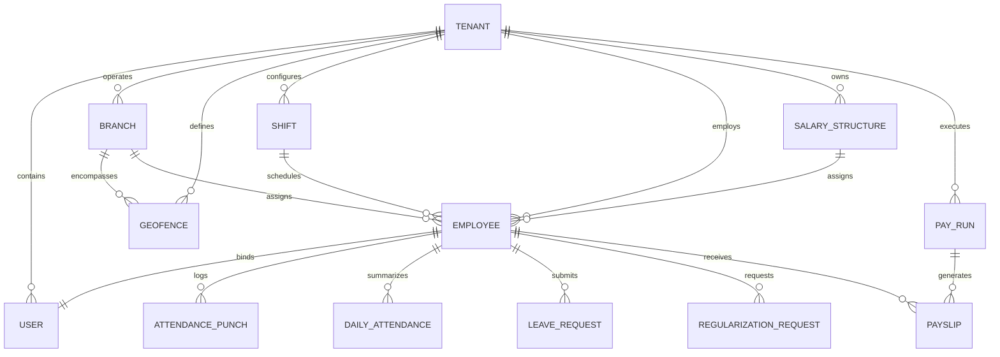

# WorkforcePro — Database Schema Specification

## 1. Multi-Tenant Data Modeling Strategy

WorkforcePro uses the **Shared Database, Isolated Schemas via Tenant Discriminator** pattern with MongoDB and Mongoose. This guarantees high resource efficiency, simplified cross-tenant operational maintenance, and robust data isolation through mandatory schema-level compound indexes and Mongoose query middleware.

### 1.1 Tenant Isolation Guarantees
1. **Mandatory `tenantId`**: Every business entity (except global system configurations) contains an immutable `tenantId: ObjectId` indexed field referencing the `tenants` collection.
2. **Compound Index Rule**: All collection queries are indexed starting with `tenantId` (e.g., `{ tenantId: 1, employeeId: 1 }`).
3. **Mongoose Tenant Scoping Plugin**: A global Mongoose pre-hook enforces `tenantId` presence on all `find`, `findOne`, `findOneAndUpdate`, `updateMany`, `deleteOne`, and `deleteMany` operations, throwing an unhandled exception if omitted.
4. **Soft Deletion**: Collections implement soft deletes via `isDeleted: Boolean` and `deletedAt: Date` to preserve audit records.

---

## 2. Entity Relationship Diagram (ERD)



---

## 3. Core Collection Definitions

### 3.1 `tenants`
Stores corporate accounts, plan quotas, and global organizational settings.

```typescript
{
  _id: ObjectId,
  name: String,                      // e.g. "Acme Corporation"
  subdomain: String,                 // unique, lowercase: e.g. "acme"
  legalRegistrationNumber: String,   // Tax / Corporate ID
  contactEmail: String,
  contactPhone: String,
  country: String,                   // ISO 3166-1 alpha-2 (e.g. "IN", "US")
  timezone: String,                  // e.g. "Asia/Kolkata", "America/New_York"
  currency: String,                  // e.g. "INR", "USD"
  fiscalYearStartMonth: Number,      // 1 to 12 (e.g. 4 for April)
  subscription: {
    plan: String,                    // "STARTER" | "PROFESSIONAL" | "ENTERPRISE"
    status: String,                  // "TRIAL" | "ACTIVE" | "PAST_DUE" | "SUSPENDED"
    maxEmployees: Number,
    validUntil: Date
  },
  settings: {
    allowMockGpsForTesting: Boolean, // strictly false in production
    enforceDeviceBinding: Boolean,   // default: true
    requireSelfieForPunch: Boolean,  // default: true
    gracePeriodMinutesDefault: Number// default: 15
  },
  createdAt: Date,
  updatedAt: Date
}
// Indexes:
// - { subdomain: 1 } (unique)
// - { status: 1 }
```

### 3.2 `users`
Authentication credentials, role assignments, and security tokens.

```typescript
{
  _id: ObjectId,
  tenantId: ObjectId,                // Ref: tenants
  email: String,                     // Unique within tenant
  passwordHash: String,              // Argon2id / bcrypt hash
  role: String,                      // "SUPER_ADMIN" | "TENANT_ADMIN" | "HR_MANAGER" | "SHIFT_SUPERVISOR" | "EMPLOYEE"
  status: String,                    // "ACTIVE" | "INACTIVE" | "SUSPENDED" | "INVITED"
  boundDeviceId: String,             // Hardware UUID / Fingerprint (null if unbound)
  deviceModel: String,               // e.g. "Samsung Galaxy S23"
  deviceBoundAt: Date,
  lastLoginAt: Date,
  lastLoginIp: String,
  passwordChangedAt: Date,
  refreshTokenHash: String,          // Hashed current refresh token
  isDeleted: Boolean,
  createdAt: Date,
  updatedAt: Date
}
// Indexes:
// - { tenantId: 1, email: 1 } (unique)
// - { tenantId: 1, boundDeviceId: 1 }
```

### 3.3 `branches` & `departments` & `designations`

```typescript
// branches
{
  _id: ObjectId,
  tenantId: ObjectId,
  code: String,                      // e.g. "HQ-01"
  name: String,                      // "Headquarters - Tech Park"
  address: {
    street: String,
    city: String,
    state: String,
    postalCode: String,
    country: String
  },
  timezone: String,
  isHeadquarters: Boolean,
  createdAt: Date,
  updatedAt: Date
}
// Indexes: { tenantId: 1, code: 1 } (unique)

// departments
{
  _id: ObjectId,
  tenantId: ObjectId,
  name: String,                      // "Engineering", "Operations"
  code: String,                      // "ENG"
  parentDepartmentId: ObjectId,      // Hierarchical hierarchy
  managerId: ObjectId,               // Ref: employees
  createdAt: Date
}
// Indexes: { tenantId: 1, code: 1 } (unique)

// designations
{
  _id: ObjectId,
  tenantId: ObjectId,
  title: String,                     // "Senior Software Engineer"
  departmentId: ObjectId,            // Ref: departments
  level: Number                      // 1, 2, 3...
}
```

### 3.4 `employees`
Enterprise employee profile, reporting hierarchy, and assignment linkages.

```typescript
{
  _id: ObjectId,
  tenantId: ObjectId,
  userId: ObjectId,                  // Ref: users (unique)
  employeeCode: String,              // e.g. "EMP-00104" (unique per tenant)
  firstName: String,
  lastName: String,
  dateOfBirth: Date,
  gender: String,                    // "MALE" | "FEMALE" | "OTHER"
  phone: String,
  emergencyContact: {
    name: String,
    relation: String,
    phone: String
  },
  branchId: ObjectId,                // Ref: branches
  departmentId: ObjectId,            // Ref: departments
  designationId: ObjectId,           // Ref: designations
  managerId: ObjectId,               // Ref: employees (reporting manager)
  shiftId: ObjectId,                 // Ref: shifts (default shift)
  assignedGeofenceIds: [ObjectId],   // Ref: geofences
  employmentType: String,            // "FULL_TIME" | "PART_TIME" | "CONTRACT" | "INTERN"
  joiningDate: Date,
  exitDate: Date,
  status: String,                    // "ACTIVE" | "PROBATION" | "RESIGNED" | "TERMINATED"
  bankDetails: {
    accountNumberEncrypted: String,  // AES-256 encrypted
    bankName: String,
    routingCode: String,             // IFSC / ABA Routing
    panOrTaxId: String               // Encrypted
  },
  salaryStructureId: ObjectId,       // Ref: salary_structures
  isDeleted: Boolean,
  createdAt: Date,
  updatedAt: Date
}
// Indexes:
// - { tenantId: 1, employeeCode: 1 } (unique)
// - { tenantId: 1, userId: 1 } (unique)
// - { tenantId: 1, branchId: 1, status: 1 }
// - { tenantId: 1, managerId: 1 }
```

### 3.5 `geofences`
Geographical physical boundaries and office coordinates for attendance validation.

```typescript
{
  _id: ObjectId,
  tenantId: ObjectId,
  branchId: ObjectId,                // Ref: branches
  name: String,                      // "Main Office Building B"
  shapeType: String,                 // "CIRCLE" | "POLYGON"
  // For GeoJSON support in MongoDB
  location: {
    type: String,                    // "Point"
    coordinates: [Number]            // [longitude, latitude]
  },
  radiusMeters: Number,              // e.g. 100 (for CIRCLE)
  polygonCoordinates: [[Number]],    // Array of [lng, lat] for POLYGON
  wifiBssids: [String],              // Optional Office Wi-Fi MAC addresses allowlist
  isActive: Boolean,
  createdAt: Date,
  updatedAt: Date
}
// Indexes:
// - { tenantId: 1, branchId: 1 }
// - { location: "2dsphere" } (Spatial index for geospatial queries)
```

### 3.6 `shifts`
Work schedules, timings, and grace parameters.

```typescript
{
  _id: ObjectId,
  tenantId: ObjectId,
  name: String,                      // "Morning General Shift"
  code: String,                      // "MGS-01"
  startTime: String,                 // "09:00" (HH:mm format)
  endTime: String,                   // "18:00" (HH:mm format)
  breakDurationMinutes: Number,      // e.g. 60
  gracePeriodMinutes: Number,        // e.g. 15 (punch until 09:15 not marked Late)
  halfDayThresholdHours: Number,     // e.g. 4.5 hours required for Half Day
  fullDayThresholdHours: Number,     // e.g. 8.0 hours required for Full Day
  overtimeMinimumMinutes: Number,    // e.g. 60 min post shift to trigger OT
  isNightShift: Boolean,             // crosses midnight boundary
  workDays: [Number],                // [1, 2, 3, 4, 5] (1=Monday, 7=Sunday)
  isActive: Boolean,
  createdAt: Date
}
// Indexes:
// - { tenantId: 1, code: 1 } (unique)
```

### 3.7 `attendance_punches` (Immutable Raw Punch Stream)
Stores every raw punch-in and punch-out event with telemetry and anti-spoof audit evidence.

```typescript
{
  _id: ObjectId,
  tenantId: ObjectId,
  employeeId: ObjectId,              // Ref: employees
  punchType: String,                 // "PUNCH_IN" | "PUNCH_OUT"
  clientTimestamp: Date,             // Reported by phone
  serverTimestamp: Date,             // Verified backend time
  coordinates: {
    latitude: Number,
    longitude: Number,
    accuracyMeters: Number
  },
  geofenceId: ObjectId,              // Ref: geofences (if matched)
  distanceFromGeofenceMeters: Number,
  isWithinGeofence: Boolean,
  isMockGpsDetected: Boolean,        // Caught by Android Location API / test provider
  isEmulatorDetected: Boolean,
  deviceId: String,
  selfieStorageKey: String,          // Private S3 object key
  livenessScore: Number,             // 0.0 to 1.0 (from ML Kit / vision pipeline)
  verificationStatus: String,        // "VERIFIED" | "FLAGGED_OUTSIDE_GEOFENCE" | "FLAGGED_MOCK_LOCATION" | "FLAGGED_LIVENESS_FAIL"
  createdAt: Date
}
// Indexes:
// - { tenantId: 1, employeeId: 1, serverTimestamp: -1 }
// - { tenantId: 1, verificationStatus: 1, serverTimestamp: -1 }
```

### 3.8 `daily_attendance` (Aggregated Attendance Records)
Daily aggregated attendance status per employee, feeding into payroll calculations.

```typescript
{
  _id: ObjectId,
  tenantId: ObjectId,
  employeeId: ObjectId,
  shiftId: ObjectId,
  date: String,                      // "YYYY-MM-DD" format for fast indexing
  firstPunchIn: {
    punchId: ObjectId,
    time: Date,
    coordinates: [Number],
    isWithinGeofence: Boolean
  },
  lastPunchOut: {
    punchId: ObjectId,
    time: Date,
    coordinates: [Number]
  },
  totalPunches: Number,
  totalWorkMinutes: Number,
  totalBreakMinutes: Number,
  lateMinutes: Number,
  earlyExitMinutes: Number,
  overtimeMinutes: Number,
  status: String,                    // "PRESENT" | "LATE" | "HALF_DAY" | "ABSENT" | "ON_DUTY" | "HOLIDAY" | "WEEK_OFF"
  isRegularized: Boolean,
  regularizationId: ObjectId,        // Ref: regularization_requests
  isManualOverride: Boolean,
  overrideBy: ObjectId,              // Ref: users
  overrideReason: String,
  createdAt: Date,
  updatedAt: Date
}
// Indexes:
// - { tenantId: 1, employeeId: 1, date: 1 } (unique)
// - { tenantId: 1, date: 1, status: 1 }
```

### 3.9 `regularization_requests` & `leave_requests`

```typescript
// regularization_requests
{
  _id: ObjectId,
  tenantId: ObjectId,
  employeeId: ObjectId,
  date: String,                      // "YYYY-MM-DD"
  reasonType: String,                // "GEOFENCE_FAIL" | "MISSED_PUNCH" | "DEVICE_FAULT" | "OUTDOOR_DUTY"
  reasonText: String,
  requestedInTime: Date,
  requestedOutTime: Date,
  status: String,                    // "PENDING" | "APPROVED" | "REJECTED"
  approverId: ObjectId,              // Ref: users
  approverComment: String,
  reviewedAt: Date,
  createdAt: Date
}
// Indexes:
// - { tenantId: 1, employeeId: 1, date: 1 }
// - { tenantId: 1, status: 1 }

// leave_requests
{
  _id: ObjectId,
  tenantId: ObjectId,
  employeeId: ObjectId,
  leaveType: String,                 // "PAID_LEAVE" | "CASUAL_LEAVE" | "SICK_LEAVE" | "UNPAID_LEAVE"
  startDate: Date,
  endDate: Date,
  isHalfDay: Boolean,
  halfDaySession: String,            // "FIRST_HALF" | "SECOND_HALF" | null
  totalDays: Number,                 // e.g. 1.0 or 0.5
  reason: String,
  status: String,                    // "PENDING" | "APPROVED" | "REJECTED" | "CANCELLED"
  approverId: ObjectId,
  approvedAt: Date,
  createdAt: Date
}
// Indexes:
// - { tenantId: 1, employeeId: 1, status: 1 }
```

### 3.10 `salary_structures` & `pay_runs` & `payslips`

```typescript
// salary_structures
{
  _id: ObjectId,
  tenantId: ObjectId,
  name: String,                      // "Standard Tech Full-Time"
  code: String,
  currency: String,                  // "INR", "USD"
  earnings: [
    {
      name: String,                  // "Basic", "HRA", "Special Allowance"
      type: String,                  // "FIXED" | "PERCENTAGE_OF_BASIC"
      amountOrPercentage: Number,
      isTaxable: Boolean
    }
  ],
  deductions: [
    {
      name: String,                  // "Provident Fund", "Professional Tax", "TDS"
      type: String,                  // "FIXED" | "PERCENTAGE_OF_BASIC" | "SLAB"
      amountOrPercentage: Number
    }
  ],
  isDefault: Boolean,
  createdAt: Date
}

// pay_runs
{
  _id: ObjectId,
  tenantId: ObjectId,
  payPeriodMonth: Number,            // 1 to 12
  payPeriodYear: Number,             // e.g. 2026
  startDate: Date,
  endDate: Date,
  status: String,                    // "DRAFT" | "PROCESSING" | "COMPLETED" | "APPROVED" | "LOCKED"
  totalEmployeesProcessed: Number,
  totalGrossPay: Number,
  totalDeductions: Number,
  totalNetPay: Number,
  executedBy: ObjectId,              // Ref: users
  approvedBy: ObjectId,              // Ref: users
  lockedAt: Date,
  createdAt: Date
}
// Indexes: { tenantId: 1, payPeriodYear: 1, payPeriodMonth: 1 } (unique)

// payslips
{
  _id: ObjectId,
  tenantId: ObjectId,
  payRunId: ObjectId,                // Ref: pay_runs
  employeeId: ObjectId,              // Ref: employees
  payPeriod: String,                 // "2026-10"
  payableDays: Number,               // Total calendar days - LOP days
  lopDays: Number,                   // Loss of pay days from attendance
  overtimeHours: Number,
  earningsBreakdown: [
    { name: String, amount: Number }
  ],
  deductionsBreakdown: [
    { name: String, amount: Number }
  ],
  grossEarnings: Number,
  totalDeductions: Number,
  netPay: Number,
  pdfStorageKey: String,             // S3 path to generated PDF
  status: String,                    // "GENERATED" | "SENT" | "ACKNOWLEDGED"
  createdAt: Date
}
// Indexes:
// - { tenantId: 1, payRunId: 1, employeeId: 1 } (unique)
// - { tenantId: 1, employeeId: 1, payPeriod: -1 }
```

### 3.11 `audit_logs` (Immutable Security Audit Stream)

```typescript
{
  _id: ObjectId,
  tenantId: ObjectId,
  actorUserId: ObjectId,             // Ref: users (null for system automated jobs)
  actorEmail: String,
  ipAddress: String,
  userAgent: String,
  action: String,                    // e.g. "AUTH_LOGIN", "ATTENDANCE_OVERRIDE", "PAYROLL_APPROVED"
  targetEntity: String,              // "daily_attendance", "employees", "pay_runs"
  targetEntityId: ObjectId,
  previousValues: Object,            // Diff snapshot
  updatedValues: Object,             // Diff snapshot
  timestamp: Date                    // Indexed
}
// Indexes:
// - { tenantId: 1, timestamp: -1 }
// - { tenantId: 1, targetEntity: 1, targetEntityId: 1 }
```

### 3.12 `attendance_punches` (Point-in-Time Punch Telemetry & Audit Stream)

```typescript
{
  _id: ObjectId,
  companyId: ObjectId,              // Tenant isolation key (Indexed)
  employeeId: ObjectId,             // Ref: employees (Indexed)
  action: String,                   // 'CHECK_IN' | 'CHECK_OUT'
  serverTimestamp: Date,            // Authoritative server NTP time (Indexed)
  clientTimestamp: Date,            // Client device timestamp (forensic telemetry)
  coordinates: {
    latitude: Number,
    longitude: Number,
    accuracyMeters: Number          // Rejection threshold if > 50m
  },
  branchId: ObjectId,               // Assigned branch for geofence verification
  branchName: String,
  shiftId: ObjectId,                // Shift active during punch
  isWithinGeofence: Boolean,        // Server-verified via Haversine formula
  distanceFromGeofenceMeters: Number,
  verificationOutcome: String,      // 'VERIFIED' | 'REJECTED' | 'OVERRIDDEN'
  rejectionReason: String,          // e.g. 'OUTSIDE_GEOFENCE', 'ACCURACY_TOO_POOR'
  photoKey: String,                 // Private object storage key: tenants/{companyId}/attendance/{uuid}.jpg
  photoSha256: String,              // Anti-replay 30-day deduplication
  idempotencyKey: String,           // Client idempotency token (Unique per tenant)
  notes: String,
  createdAt: Date,
  updatedAt: Date
}
// Indexes:
// - { companyId: 1, employeeId: 1, serverTimestamp: -1 }
// - { companyId: 1, idempotencyKey: 1 } (unique)
// - { companyId: 1, verificationOutcome: 1 }
```

### 3.13 `daily_attendance` (Aggregated Daily Attendance Lifecycle)

```typescript
{
  _id: ObjectId,
  companyId: ObjectId,              // Tenant isolation key (Indexed)
  employeeId: ObjectId,             // Ref: employees (Indexed)
  date: String,                     // YYYY-MM-DD (Indexed)
  shiftId: ObjectId,                // Ref: shifts
  branchId: ObjectId,               // Ref: branches
  checkInTime: Date,                // Authoritative first punch-in timestamp
  checkOutTime: Date,               // Authoritative latest punch-out timestamp
  totalWorkMinutes: Number,         // Computed working duration
  status: String,                   // 'PRESENT' | 'HALF_DAY' | 'LATE' | 'ABSENT' | 'CHECKED_IN'
  isOverridden: Boolean,            // True if updated by HR administrative action
  overrideReason: String,
  overriddenBy: ObjectId,           // Ref: users (admin/HR)
  punches: [{
    punchId: ObjectId,              // Ref: attendance_punches
    action: String,
    timestamp: Date,
    verificationOutcome: String,
    photoKey: String
  }],
  createdAt: Date,
  updatedAt: Date
}
// Indexes:
// - { companyId: 1, employeeId: 1, date: 1 } (unique)
// - { companyId: 1, date: 1, status: 1 }
```
