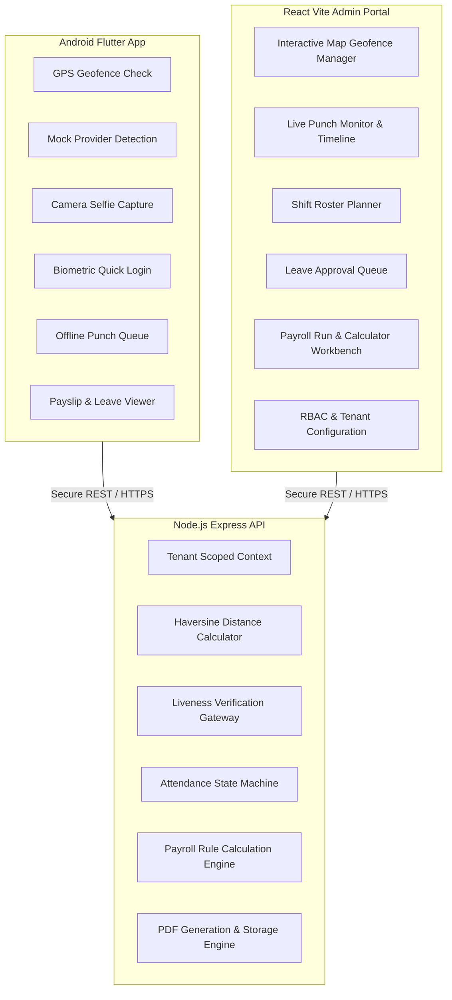

# WorkforcePro — Feature Matrix

This document provides a breakdown of all system features across platforms (Mobile, Web Admin, API), user roles, and implementation milestones.

---

## 1. Feature Availability by Platform & Role

| Module | Feature Description | Android App (Mobile) | Web Admin Portal | API Service | Target Roles | Phase |
| :--- | :--- | :---: | :---: | :---: | :--- | :---: |
| **Authentication** | Email & Password Login | Yes | Yes | Yes | All Users | Phase 1 |
| | Multi-Factor Authentication (TOTP / SMS) | Future | Yes | Yes | Admin / HR | Phase 3 |
| | Biometric App Unlock (Fingerprint / Face ID) | Yes | N/A | No (Client only) | Employee | Phase 2 |
| | Device Binding & Hardware Fingerprint Lock | Yes | View / Reset | Yes | Employee / Admin | Phase 1 |
| | Password Reset / Forgot Password Flow | Yes | Yes | Yes | All Users | Phase 1 |
| **Organization Management** | Tenant Onboarding & Profile Setup | No | Yes | Yes | Super Admin / Admin | Phase 1 |
| | Branch / Office Location Management | No | Yes | Yes | Admin / HR | Phase 1 |
| | Department & Designation Hierarchy | No | Yes | Yes | Admin / HR | Phase 1 |
| | Employee Master Directory (CRUD) | Directory View | Full Management | Yes | All (Scoped) | Phase 1 |
| | Custom Role & Granular RBAC Permissions | No | Yes | Yes | Admin | Phase 2 |
| **Geofencing & Sites** | Circular Geofence Definition (Lat/Lng + Radius) | No | Yes (Map UI) | Yes | Admin / HR | Phase 1 |
| | Polygon Geofence Definition | No | Yes (Map UI) | Yes | Admin / HR | Phase 3 |
| | Wi-Fi BSSID Allowlists (Office Wi-Fi Tagging) | Check | Configure | Yes | Admin / HR | Phase 2 |
| | Geofence Assignment (Branch / Dept / Individual) | No | Yes | Yes | Admin / HR | Phase 1 |
| **Attendance Tracking** | Geofenced Punch In / Punch Out | Yes | View Logs | Yes | Employee | Phase 1 |
| | Live Selfie Verification (Camera Capture) | Yes | View Audit Photo | Yes | Employee | Phase 1 |
| | Mock Location / GPS Spoofing Detection | Yes (Block) | Audit Alerts | Yes | Employee / Admin | Phase 1 |
| | Passive Liveness Detection (Anti-Photo Spoof) | Yes | Review Flagged | Yes | Employee | Phase 2 |
| | Server-Verified Network Time Sync | Yes | View Timestamps | Yes | System / All | Phase 1 |
| | Offline Punch Caching & Encrypted Sync | Yes | Review Synced | Yes | Employee / Admin | Phase 2 |
| | Shift Rostering & Assignment | View Shift | Full Rostering | Yes | All | Phase 1 |
| | Automated Status (Present/Late/Half-day/Absent) | View Status | Manage / Recalculate | Yes | All | Phase 1 |
| | Attendance Regularization Workflow | Request | Approve / Reject | Yes | Employee / Manager | Phase 1 |
| **Leave Management** | Leave Category Setup & Policy Configuration | View Policies | Full Management | Yes | Admin / HR | Phase 1 |
| | Leave Balance Tracking & Accruals | View Balance | Adjust Balances | Yes | Employee / Admin | Phase 1 |
| | Leave Application Submission | Submit | Submit on behalf | Yes | Employee / Manager | Phase 1 |
| | Multi-Level Leave Approval Flow | Notification | Approve / Reject | Yes | Manager / HR | Phase 1 |
| | Company Holiday Calendar by Branch | View Holidays | Full Management | Yes | All | Phase 1 |
| **Payroll Processing** | Salary Component Builder (Earnings/Deductions) | No | Yes | Yes | Admin / HR | Phase 2 |
| | Employee Salary Structure Assignment | View Summary | Full Management | Yes | Employee / Admin | Phase 2 |
| | Attendance-Linked Pay Run (LOP, Late, OT) | No | Execute & Preview | Yes | Admin / HR | Phase 2 |
| | Statutory Rules Engine (Parameterized Tax/PF) | No | Configure | Yes | Admin / HR | Phase 2 |
| | Pay Run Review & Approval Lifecycle | No | Multi-step Approve | Yes | Admin / HR | Phase 2 |
| | Payslip Generation (PDF) & Delivery | View / Download | Bulk Generate / Send | Yes | Employee / Admin | Phase 2 |
| | Bank Disbursement Sheet Export (CSV/XLSX) | No | Export | Yes | Admin / HR | Phase 2 |
| **Reporting & Audit** | Daily Attendance Summary Dashboard | No | Interactive Charts | Yes | Admin / HR / Manager | Phase 1 |
| | Employee Timesheet Export (CSV/PDF) | No | Filter & Export | Yes | Admin / HR | Phase 1 |
| | Monthly Payroll Cost & Tax Reports | No | Full Analytics | Yes | Admin / Finance | Phase 2 |
| | Security Audit Trail (Punches, Logins, Overrides)| No | Filter & Search | Yes | Super Admin / Admin | Phase 1 |

---

## 2. Granular Role-Based Access Control (RBAC) Matrix

| Resource / Action | Super Admin | Tenant Admin | HR Manager | Shift Supervisor | Employee |
| :--- | :---: | :---: | :---: | :---: | :---: |
| **Tenant Settings** | Full Control | Manage Own | View Only | None | None |
| **Company Structure** | Full Control | Full Control | Manage | View Only | View Directory |
| **Employee Profiles** | Full Control | Full Control | Full Control | View Team | View Own Profile |
| **Geofences & Sites** | View System | Full Control | Manage | View Assigned | View Assigned |
| **Punches & Logs** | System Audit | View All | View All / Edit | View Team | Own Punches Only |
| **Regularizations** | System Audit | Override All | Approve / Reject | Approve Team | Submit Own |
| **Leave Requests** | System Audit | Override All | Approve / Reject | Approve Team | Submit Own |
| **Salary Structures** | System Audit | Full Control | Manage | None | View Own (Locked) |
| **Payroll Runs** | System Audit | Execute / Approve | Prepare / Review | None | None |
| **Payslips** | System Audit | Generate / Export | Generate / Export | None | View / Download Own |
| **Security Audit Logs** | Full Control | Tenant Audit | Restricted Audit | None | None |

---

## 3. Platform Capabilities Comparison

