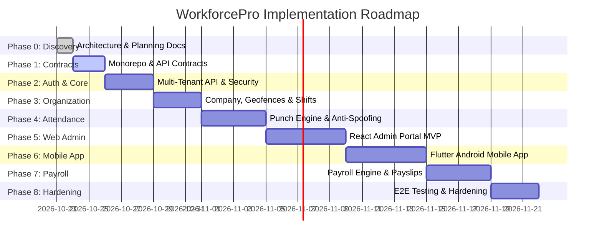

# WorkforcePro — Implementation Roadmap & Phases

This roadmap outlines the systematic, phased implementation of WorkforcePro. In accordance with project governance rules, each phase is executed independently, verified with automated tests, and halted for review prior to initiating the subsequent phase.

---

## 1. Phase Breakdown & Milestones

---

## 2. Detailed Phase Specifications

### Phase 0: Project Discovery & Architecture Planning (Current Phase)
* **Goal**: Establish complete architectural specifications, threat models, database schemas, API contracts, research reports, and rules without premature code execution.
* **Deliverables**:
  - `docs/PRODUCT_REQUIREMENTS.md`
  - `docs/FEATURE_MATRIX.md`
  - `docs/ARCHITECTURE.md`
  - `docs/DATABASE_SCHEMA.md`
  - `docs/API_SPECIFICATION.md`
  - `docs/SECURITY_MODEL.md`
  - `docs/REPOSITORY_AUDIT.md`
  - `docs/ATTENDANCE_RULES.md`
  - `docs/PAYROLL_RULES.md`
  - `docs/TESTING_STRATEGY.md`
  - `docs/IMPLEMENTATION_PHASES.md`
  - Monorepo structure, `.gitignore`, `.env.example`, `README.md`
* **Exit Gate**: Complete peer review and stakeholder sign-off on discovery documentation.

---

### Phase 1: Monorepo Foundation & Shared API Contracts
* **Goal**: Initialize workspace package manager and build the strongly-typed contracts package.
* **Tasks**:
  - Configure root `package.json` workspace structure (`apps/*`, `packages/*`).
  - Create `packages/api-contracts` containing shared TypeScript types, enums, and Zod schemas for Auth, Attendance, Organization, and Payroll.
  - Configure build scripts (`tsc`), linting (`eslint`), and formatting (`prettier`).
* **Exit Gate**: 100% type-checking passing on contracts; unit tests validating Zod schemas.

---

### Phase 2: Backend Core — Multi-Tenant Architecture & Authentication
* **Goal**: Stand up the Node.js Express TypeScript API with robust multi-tenant boundaries and authentication.
* **Tasks**:
  - Configure Clean Architecture folder structure (`domain`, `application`, `interfaces`, `infrastructure`).
  - Implement Mongoose connection pooling and `tenantScopedPlugin`.
  - Implement Tenant onboarding, User registration, Argon2id password hashing, and JWT + Refresh Token rotation.
  - Implement Express error handlers, Pino logging, and boundary security middlewares (Helmet, CORS, Rate Limiting).
* **Exit Gate**: Automated integration test suite running with in-memory MongoDB verifying tenant isolation and auth flows.

---

### Phase 3: Core Domain — Organizations, Geofences & Shifts
* **Goal**: Implement structural enterprise building blocks.
* **Tasks**:
  - CRUD operations for Branches, Departments, Designations, and Employees.
  - Geospatial Geofence service supporting circular boundaries and 2dsphere spatial indexing.
  - Shift definitions (timings, grace periods, half-day/full-day thresholds, night shift support) and employee shift assignment.
* **Exit Gate**: Unit and integration tests validating geofence coordinates and shift roster assignments.

---

### Phase 4: Field Attendance & Anti-Spoofing Engine
* **Goal**: Implement the core attendance punch ingestion pipeline and daily attendance state aggregator.
* **Tasks**:
  - Implement `POST /api/v1/attendance/punch` with multipart parsing for selfie upload.
  - Integrate server-side Haversine distance calculator.
  - Enforce hardware device binding and mock GPS rejection guards.
  - Build the Daily Attendance State Machine (`Scheduled` $\rightarrow$ `Present`, `Late`, `HalfDay`, `Absent`).
  - Implement Attendance Regularization request and review workflows.
* **Exit Gate**: Integration test suite simulating punch scenarios (valid, outside geofence, mock location, clock skew).

---

### Phase 5: Web Admin Portal (React + Vite + TypeScript)
* **Goal**: Build the administrative portal for HR managers and tenant admins.
* **Tasks**:
  - Scaffold React Vite TypeScript app with dark/light theme design system.
  - Implement Authentication flow, JWT storage, and protected route guards.
  - Build Dashboard overview (real-time punch counter, attendance pie charts).
  - Build Interactive Geofence Map Builder (Leaflet / Mapbox) for defining office sites.
  - Build Employee Directory, Shift Rostering, and Regularization Approval Queue.
* **Exit Gate**: Component unit tests and Playwright admin flow tests passing.

---

### Phase 6: Android Employee Mobile Application (Flutter + Dart)
* **Goal**: Build the secure Android employee self-service mobile client.
* **Tasks**:
  - Scaffold Flutter project with clean BLoC architecture.
  - Implement login and hardware device binding integration.
  - Implement Geofenced Punch screen with front-camera selfie preview.
  - Implement native Android Platform Channels for `Location.isMock()` detection and root checks.
  - Build punch history calendar, shift schedule viewer, and regularization request forms.
* **Exit Gate**: Flutter unit and widget tests passing; successful Android emulator execution.

---

### Phase 7: Automated Payroll Engine & Payslips
* **Goal**: Implement end-to-end payroll processing linked to attendance records.
* **Tasks**:
  - Build Salary Structure definition and assignment service.
  - Build Monthly Pay Run batch processor calculating LOP deductions from daily attendance records, overtime hours, and parameterized tax slabs.
  - Build Web Admin Pay Run review, variance analysis, and approval screen.
  - Build PDF payslip generation worker and S3 upload pipeline.
  - Implement bank disbursement CSV export.
* **Exit Gate**: Unit tests verifying payroll calculation edge cases across 28, 29, 30, and 31-day months.

---

### Phase 8: Hardening, E2E Security Audit & Production Readiness
* **Goal**: Final system validation, security audits, and deployment preparation.
* **Tasks**:
  - Comprehensive end-to-end integration testing across Mobile, Web Admin, and API.
  - Multi-tenant security penetration tests (automated cross-tenant leak attempts).
  - Docker containerization for API and Web Admin (`Dockerfile`, `docker-compose.yml`).
  - Production deployment and environment runbooks.
* **Exit Gate**: Clean dependency vulnerability scan (`npm audit`), 0 lint warnings, complete documentation sign-off.
