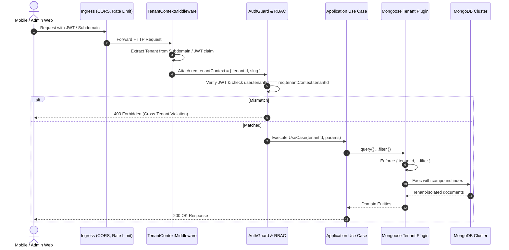

# WorkforcePro — Tenant Isolation & Security Model

## 1. Threat Modeling & Attack Vectors

WorkforcePro operates in an environment where malicious actors may include external attackers, dishonest employees attempting buddy punching or time theft, and rogue tenant administrators attempting cross-tenant surveillance.

| Threat Category | Specific Attack Vector | Severity | Mitigation in WorkforcePro |
| :--- | :--- | :---: | :--- |
| **Multi-Tenancy** | Cross-tenant data leakage via missing `tenantId` in queries | Critical | Mandatory Mongoose tenant scoping plugin + Express tenant context injection. Automated integration tests verify isolation. |
| **Attendance Fraud** | Android mock location apps (Fake GPS, Mock Loc) | High | Native `Location.isMock()` detection, developer options inspection, and server-side spatial cross-checks. |
| **Attendance Fraud** | Static photo / screen playback selfie spoofing | High | Camera front-lock, random passive/active liveness challenges (blink/smile), and server-side image hash verification. |
| **Attendance Fraud** | Buddy punching (signing in on colleague's device) | High | Hardware device binding (unique hardware fingerprint locked to employee record). |
| **Attendance Fraud** | Device clock manipulation (rolling back phone clock) | Medium | Strict rejection of client timestamps; attendance calculations driven strictly by server NTP time. |
| **Authentication** | Token theft / session hijacking | High | Short-lived access tokens (15m), secure HttpOnly cookies, and Redis-backed refresh token rotation with immediate revocation. |
| **Data Protection** | Exposure of PII and banking data in DB breaches | High | AES-256 field-level encryption for bank account numbers, tax identifiers, and emergency contacts. |
| **Supply Chain** | Hardcoded secrets or leaked API keys | Critical | Zero-tolerance policy; `.env` separation, secret scanning, environment variable injection only. |

---

## 2. Multi-Tenant Logical Isolation Architecture

WorkforcePro implements defense-in-depth isolation across all layers:



### 2.1 The Invariant Rule: Mandatory `tenantId` Filter
Every MongoDB query without exception must include `tenantId`. A custom Mongoose plugin intercepts queries:
```typescript
// Architectural Rule: apps/api/src/infrastructure/database/tenantPlugin.ts
export function tenantScopedPlugin(schema: mongoose.Schema) {
  schema.add({
    tenantId: {
      type: mongoose.Schema.Types.ObjectId,
      ref: 'Tenant',
      required: true,
      index: true
    }
  });

  const queryMethods = ['find', 'findOne', 'findOneAndUpdate', 'updateMany', 'countDocuments', 'deleteOne', 'deleteMany'];
  queryMethods.forEach((method) => {
    schema.pre(method as any, function () {
      const filter = this.getFilter();
      if (!filter.tenantId && !this.getOptions()?.bypassTenantCheck) {
        throw new Error(`[SECURITY] Cross-tenant query blocked: Missing mandatory tenantId filter.`);
      }
    });
  });
}
```

---

## 3. Authentication & Session Security

### 3.1 Password Security
* Passwords must meet minimum complexity: 10+ characters, 1 uppercase, 1 lowercase, 1 number, 1 special symbol.
* Passwords are hashed using **Argon2id** (memory cost: 64MB, iterations: 3, parallelism: 1) or salted **Bcrypt** (cost factor 12).
* Passwords are never returned in responses or recorded in logs.

### 3.2 Token Architecture
* **Access Token**: JWT signed with RS256 (asymmetric private/public key) or HMAC-SHA256 with high-entropy secret.
  - TTL: 15 minutes.
  - Payload: `{ sub: userId, tenantId: tenantId, role: role, employeeId: employeeId }`.
* **Refresh Token**: Opaque cryptographically random 256-bit string stored hashed in MongoDB.
  - TTL: 30 days.
  - Storage: HTTP-only, Secure, SameSite=Strict cookie for Web Admin; encrypted keystore (`flutter_secure_storage`) for Mobile.
  - Rotation: Using a refresh token issues a new refresh token and invalidates the previous one immediately.
* **Token Revocation List**: Managed in Redis with TTL matching the access token expiration window.

---

## 4. Mobile Device Binding & Hardware Integrity

To prevent an employee from logging in on another employee's device to mark proxy attendance:
1. **Binding Flow**:
   - On initial login, the Android app extracts hardware telemetry: Android ID, build serial, hardware board, and device manufacturer.
   - It computes a cryptographic hardware identifier `deviceId`.
   - If the user has no bound device, the server stores `boundDeviceId = deviceId`.
   - Subsequent punch requests must transmit `deviceId` in signed request headers.
2. **Device Enforcement**:
   - If `req.deviceId !== user.boundDeviceId`, the punch is rejected immediately with code `DEVICE_MISMATCH`.
3. **Device Reset Governance**:
   - Re-binding a new phone requires HR Admin intervention or an audited manager reset action.

---

## 5. Network & Transport Security

* **TLS 1.3**: All incoming connections terminated with TLS 1.3 only; legacy TLS 1.0/1.1 disabled.
* **HSTS**: `Strict-Transport-Security: max-age=63072000; includeSubDomains; preload`.
* **CORS**: Explicit origins allowlist per tenant domain. Wildcards (`*`) strictly prohibited on authenticated routes.
* **Rate Limiting**:
  - Global tier: 100 requests / minute / IP.
  - Auth tier (`/auth/login`): 5 attempts / 5 minutes / IP (blocks brute-force attacks).
  - Punch tier (`/attendance/punch`): 10 punches / 5 minutes / employee.

---

## 6. Audit Logging & Non-Repudiation

Every state-altering operation produces an append-only, tamper-evident audit record in the `audit_logs` collection:
* Immutable: No update or delete operations permitted on `audit_logs`.
* Records actor identity, IP address, user-agent, action type, target entity, and before/after diff snapshot.
* Retained for a minimum of 7 years to satisfy statutory compliance and corporate labor audits.
